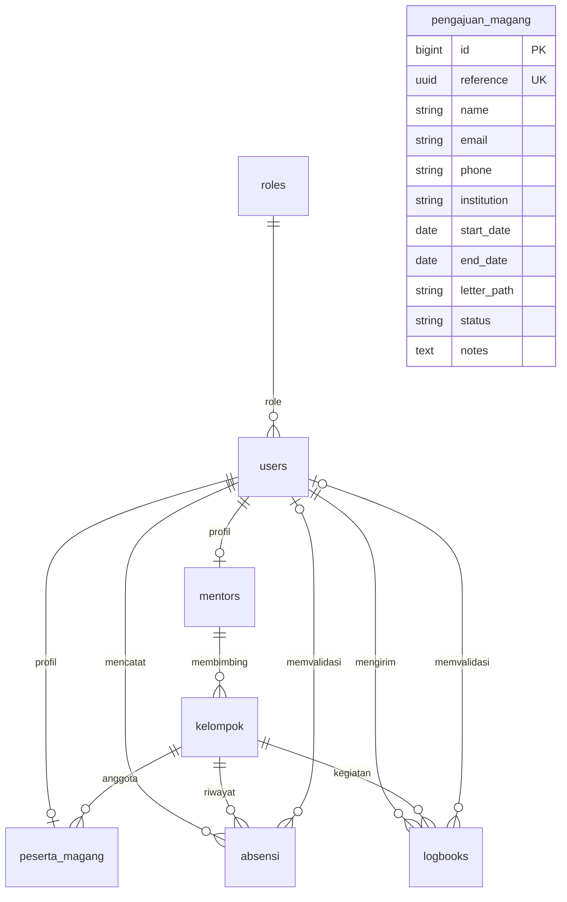

# Struktur database MONIKA

Migrasi merupakan definisi kolom, indeks unik, foreign key, dan rollback yang sebenarnya. Semua ID utama memakai BIGINT unsigned. Pengajuan memakai UUID referensi tambahan. Password di-hash oleh Laravel.

| Tabel | Relasi / aturan |
|---|---|
| roles | Nama peran sebagai primary key: admin, mentor, ketua, peserta |
| users | Email unik, role FK, active boolean, password hash |
| mentors | user_id unik; division |
| kelompok | Nama unik; mentor_id wajib; rentang tanggal divalidasi backend |
| peserta_magang | user_id unik; kelompok_id wajib; institution, student_number |
| pengajuan_magang | Independen dari akun; reference unik; surat privat; tidak ada auto-provision |
| absensi | user_id, kelompok_id, date, description, status, reviewer_id, feedback, reviewed_at; unik (user_id,date) |
| logbooks | Struktur serupa absensi; unik (kelompok_id,date) |

Penghapusan profil mengikuti akun; penghapusan akun pengirim dan kelompok yang sudah dipakai riwayat dibatasi FK. Penghapusan reviewer mengosongkan reviewer_id. Pengecekan role, periode, dan mentor dilakukan server. Setiap catatan menyimpan kelompok pada waktu pengiriman.
